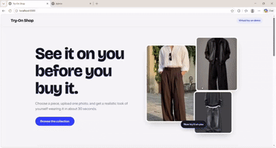

# Try-On Shop Feature

A virtual try-on test store powered by **Perfect Corp's `cloth-v4` API**.

Try on clothing products by uploading a photo and selecting a garment from the store. The application also includes an admin dashboard for managing products and monitoring try-on activity.

## Demo


<p align="center">
  
</p>

## Features

- **Virtual Try-On:** Generate clothing try-on results using Perfect Corp's `cloth-v4` API.
- **Product Management:** Add products through image URLs, file uploads, or Pexels search.
- **Admin Dashboard:** Manage products and monitor try-on activity.
- **Usage Limits:** Limit the number of try-ons per visitor to protect API credits.
- **Feedback Collection:** Collect thumbs-up/down ratings and user comments.
- **Activity Tracking:** Record try-on details, processing time, status, and errors.

## Tech Stack

- Python
- FastAPI
- SQLite
- Perfect Corp `cloth-v4` API
- HTML, CSS, JavaScript

## Getting Started

### Requirements

- Ubuntu / WSL
- Python
- A Perfect Corp API key

### Installation

Extract the project and navigate to its directory:

```bash
unzip tryon-shop.zip
cd tryon-shop
```

Run the application setup:

```bash
./run.sh
```

On the first run, the script creates a virtual environment (`.venv`) and an `.env` file, then stops.

Configure your environment variables:

```bash
nano .env
```

Set the required values:

```env
PERFECT_API_KEY=your_perfect_corp_api_key
ADMIN_PASSWORD=your_admin_password

# Optional
PEXELS_API_KEY=your_pexels_api_key
```

Start the application:

```bash
./run.sh
```

### Access the Application

| Interface | URL |
|---|---|
| Online Store | http://localhost:8000 |
| Admin Dashboard | http://localhost:8000/admin |

The admin dashboard accepts any username; the password must match `ADMIN_PASSWORD`.

## Managing Products

Navigate to **Admin → Products** to add clothing items using:

- An image URL.
- A locally uploaded image.
- Pexels search (requires `PEXELS_API_KEY`).

For better virtual try-on results, use product images that show:
- A single garment.
- A front-facing view.
- A clearly visible clothing item.

Set the appropriate category when adding a product:

- `upper_body`
- `lower_body`
- `full_body`

**Note:** Pinterest is not supported because its terms prohibit scraping. Only use images you have permission to use.

## Data & Activity Tracking

The application stores try-on activity locally in the `data/` directory.

For each try-on, the application records:

- Visitor cookie ID.
- IP address and browser information.
- Selected product.
- Uploaded photo and generated result.
- Task ID, status, and error details.
- Processing time (upload + generation).
- User feedback (thumbs up/down and comments).

Data is stored in:

```text
data/
├── shop.db
├── uploads/
├── results/
└── products/
```

The `MAX_TRYONS_PER_VISITOR` setting controls the maximum number of try-ons allowed per visitor.

## Privacy & Security

**Uploaded photos may contain real people and are stored locally.**

- Keep the consent checkbox enabled.
- Protect access to the admin dashboard.
- Never commit `.env`, API keys, or private user data to GitHub.
- Delete the `data/` directory when testing is complete if the stored data is no longer needed.

